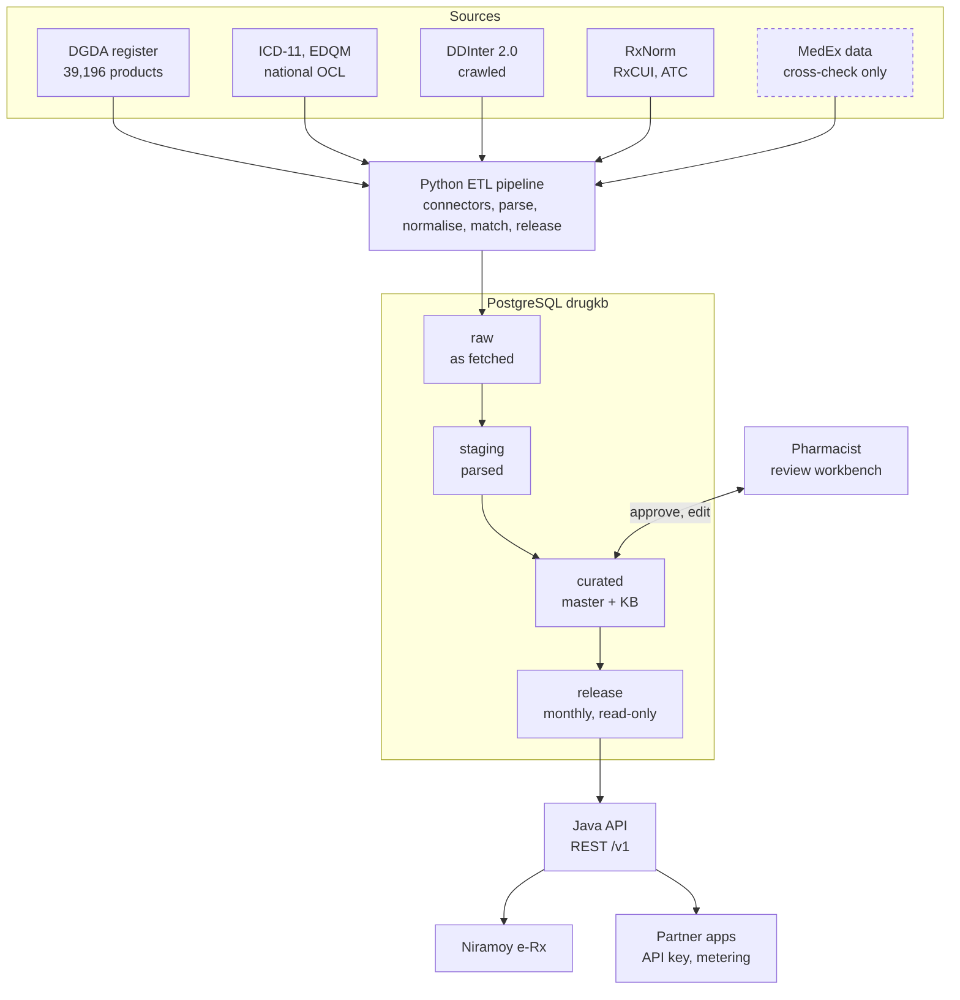

# BD Drug Knowledge Base — Design Proposal

Approved 11 Oct 2026 · Author: Khondoker Tanvir Hossain · Living copy: https://claude.ai/code/artifact/62df7be9-d0cc-4706-a020-1473b1ea1f38

## Summary

We are building **BDDrug KB**, an authoritative Bangladesh drug knowledge base with interaction data, served through a hosted REST API. Niramoy's e-Rx uses it first; partner companies follow under agreement.

- **Drug master.** Three levels: Substance (INN) → Clinical drug (substance + strength + dose form) → Brand, keyed on the DGDA DAR number. Every substance carries crosswalk codes: ATC, ICD-11 XM, RxNorm RxCUI, DDInter ID, DrugBank ID.
- **Brand source.** The official DGDA register on the national OCL terminology server (39,196 products), not the MedEx data we scraped.
- **Interaction source.** DDInter 2.0 (drug–drug, drug–disease, drug–food, therapeutic duplication), crawled with the authors' agreement.
- **Quality.** Dedicated pharmacists verify every mapping the API exposes. Each row records its source and who verified it.
- **Timeline.** About 12 weeks to a partner-ready v1.

## Context and findings

Our current drug catalog can't support safety checks or partner use. Two better sources exist, and we verified both on 11 Oct 2026.

| Source | What it holds | Problems found |
| --- | --- | --- |
| Current `prescription` DB (scraped from medex.com.bd) | 1,711 generics (`MedicineGenerics`), 33,327 brands (`Medicines`) | 4,594 brands (14%) have no `GenericId`, because generic names carry salt suffixes ("Ceftriaxone Sodium" vs "Ceftriaxone"). 543 brands have a name that differs from their master generic. 195 brands have the generic "Topical". `PrescriptionMedicines` is test data (91,969 of 92,339 lines are Paracetamol). We can't redistribute this data to partners. |
| [DGDA register on the national OCL server](https://fhir.dghs.gov.bd/core/CodeSystem-dgda-drug-registry.json.html) (MoHFW, `api.tr.ocl.dghs.gov.bd`) | 39,196 registered products, each with DAR number, trade name, company, dosage form and raw ingredient/strength text, mapped to ICD-11 XM substance codes. EDQM dose forms, LOINC and ICD-11 MMS are on the same server. | Ingredient and strength are free text ("Amphotericin B 50 mg/vial") and must be parsed. A `dar_quality_flag` field suggests known data issues. Last updated 27 Mar 2026. |
| [DDInter 2.0](https://ddinter2.scbdd.com/) | 2,290 substances (`DDInter1`–`DDInter2290`), 302,516 drug–drug records, 8,359 drug–disease, 857 drug–food, 6,033 duplication records. Interaction and management text and references. ATC and DrugBank ID per drug. | US naming (Acetaminophen, Glyburide, Epinephrine). Some entries are split by route ("Chloramphenicol (ophthalmic)"). No RxCUI. Drugs used in Bangladesh but not in the US (domperidone, drotaverine, tolperisone, itopride, aceclofenac) are absent. The only bulk download is the v1 CSV set (160,235 pairs, severity only), so 2.0 must be crawled. |
| RxNorm (NLM) | US standard drug codes (RxCUI), synonyms, and ATC via RxClass | US market only, so many Bangladeshi generics and most herbals have no RxCUI |

**Takeaway:** use the DGDA register as the backbone for brands, DDInter for interaction content, and RxNorm and ATC for crosswalks. Keep the MedEx data for internal cross-checks only.

## Requirements and assumptions

| Topic | Decision |
| --- | --- |
| Consumers | Niramoy e-Rx first, then partner companies under agreement |
| Delivery | Hosted REST API only in v1. Bulk downloads and a FHIR terminology server come later; the schema stays FHIR-friendly. |
| Product scope | All DGDA categories: allopathic, vaccines and biologics, herbal / Unani / Ayurvedic, supplements / OTC / cosmetics |
| Depth | Three levels: Substance → Clinical drug → Brand. Packs, MRP and barcodes are deferred. |
| Interaction source | DDInter 2.0, crawled with the authors' agreement. The business owns the licence. |
| Backbone ID | Our own permanent substance ID (`BDS-000123`). External codes are crosswalks. |
| Curation | Dedicated pharmacist(s), working in a review workbench with an audit trail |
| Stack | Python ETL, Java 21 / Spring Boot WebFlux API, PostgreSQL |

**v1 success targets**

- ≥95% of DGDA allopathic products mapped to a substance with an ATC code
- ≥90% of the top 500 generics linked to DDInter
- 100% of mappings exposed through the API verified by a pharmacist
- API p95 latency under 300 ms for an interaction check

**Assumptions**

- The DGDA register on OCL is the source of truth for brands. MedEx-derived data is never served to partners.
- The "top 500 generics" are ranked by number of registered brands, because we have no real prescribing data yet.
- RxNorm is used under the free UMLS licence; only RxNorm-sourced content is redistributed.
- WHO ATC/DDD terms for commercial products are on the business's licence checklist alongside DDInter.

## Architecture overview

Data flows one way: sources → Python ETL → four PostgreSQL layers → a Java API that serves only the published release. Partners only ever see the reviewed monthly release.

The dashed MedEx box is internal: it is used for cross-checks and never reaches a release. Pharmacist decisions write into the curated layer; the monthly release is a read-only snapshot of it, so every API answer can be traced to a release version.

## Data model

Every brand resolves to a clinical drug, and every clinical drug to one or more substances. Interactions attach to substances, so one DDInter record covers every brand containing that ingredient.

Example: **Napa 500 mg tablet** (Beximco, a DAR number) → *Paracetamol 500 mg oral tablet* → **Paracetamol** (`BDS-…`, ATC N02BE01, RxCUI 161, DDInter14 "Acetaminophen").

**Substance level**

| Table | Key columns | Purpose |
| --- | --- | --- |
| `substance` | `bds_id` (permanent), `preferred_name` (INN), `kind` (allopathic, biologic, vaccine, herbal, supplement, other), `status` | One row per active ingredient |
| `substance_name` | `bds_id`, `name`, `name_type` (INN, BAN, USAN, salt, local, Bengali, DDInter, DGDA raw) | Resolves Paracetamol↔Acetaminophen and Glibenclamide↔Glyburide |
| `substance_code` | `bds_id`, `system` (ATC, ICD11_XM, RXCUI_IN, DDINTER, DRUGBANK, UNII), `code` + provenance | Crosswalks; many-to-many |
| `salt_form` | `salt_name`, parent `bds_id`, strength basis | Amlodipine besilate → amlodipine |

**Clinical drug level** (similar to an RxNorm SCD)

| Table | Key columns | Purpose |
| --- | --- | --- |
| `clinical_drug` | `bdc_id`, EDQM `dose_form`, `route`, normalised display name | "Amlodipine 5 mg oral tablet" |
| `clinical_drug_ingredient` | `bdc_id`, `bds_id`, `strength_value`, `unit`, `per_value`, `per_unit`, `basis` (salt or base) | One row per ingredient; combinations have several |

**Brand level**

| Table | Key columns | Purpose |
| --- | --- | --- |
| `brand_product` | `dar_number` (natural key), `ocl_concept_id`, `trade_name`, `company`, `dosage_form_raw`, `generic_content_raw`, `bdc_id`, `category`, `dgda_status` | One row per DGDA-registered product |
| `interaction_coverage` | `bdc_id` or `bds_id`, `coverage` (full, partial, none) | So the API never presents "no data" as "no interactions" |

**Interaction knowledge base** (keyed on our substances)

| Table | Key columns | Notes |
| --- | --- | --- |
| `ddi` | `bds_a < bds_b`, `severity` (major, moderate, minor, unknown), mechanism flags, `text_id`, `route_scope`, `ddinter_interaction_id` | About 300k pairs; `route_scope` separates ophthalmic, topical, nasal and systemic |
| `interaction_text` | `text_id`, interaction, management, references | About 8,400 distinct texts shared across pairs |
| `drug_disease` | `bds_id`, `condition_name`, ICD-11 / ICD-10 codes, severity, text, references | Disease names mapped to codes and reviewed by a doctor |
| `drug_food` | `bds_id`, food, severity, mechanism, description, management | 857 records, 29 foods |
| `duplication` | DDInter class or combination records, warning, note | Plus a same-substance check derived from the master |

**Provenance, review and audit**

- Every curated row carries `source`, `source_version`, `fetched_at`, `method` (exact, synonym, fuzzy, manual), `confidence`, `verified_by` and `verified_at`.
- `review_task` and `review_decision` hold the pharmacist queue and an append-only decision log.
- `source_release` records each source pull with row counts and checksum.

## Data sources and ETL pipeline

A Python pipeline (`bddrug-etl`) pulls each source into an immutable raw store, then parses, normalises and matches the data. Anything uncertain goes to pharmacist review.

| Connector | Source | Method | Refresh |
| --- | --- | --- | --- |
| `ocl_dgda` | DGDA-Drugs on `api.tr.ocl.dghs.gov.bd` | Public REST API, concepts with mappings | Monthly |
| `ocl_terms` | ICD-11 XM and MMS, EDQM dose forms on the same server | Public REST API | Per source release |
| `ddinter_crawler` | `ddinter2.scbdd.com` | Drug list → `grapher-datasource` (pairs) → `interact-with-dis` / `-food` / `-multi` (session + CSRF token) → `/server/interact/{id}/` pages for the text. About 1 request per second, checkpointed. | Quarterly |
| `rxnorm` | NLM RxNorm full release (UMLS) + RxClass | File load + API | Monthly |
| `medex_internal` | Existing `prescription` DB | Read-only, for cross-checks only | On demand |

**Processing steps**

1. **Parse.** Split `generic_content_raw` into ingredients with strength and unit ("X 500 mg + Y 125 mg"). Map dose forms to EDQM. Read DDInter route qualifiers.
2. **Normalise.** Fold case and Unicode, strip salts and hydrates (besilate, sodium, hydrochloride, dihydrate…), unwrap brackets ("Vitamin C [Ascorbic acid]"). Apply an INN / BAN / USAN synonym table, seeded from RxNorm and grown from pharmacist decisions.
3. **Match.** Try strategies in order: code (ICD-11 XM, DrugBank, UNII) → exact name → synonym → salt parent → fuzzy. Each candidate records its method and score. Low scores and conflicting signals become review tasks.
4. **Review.** Pharmacists approve, reject or edit candidates in the workbench.
5. **Release.** QA gates run, then `curated` is snapshotted into a read-only monthly release (e.g. `2026.11`), diffed against the previous release, with a coverage report published. The API serves only released data.

## Pharmacist review workbench

- **Queue** filtered by reason (fuzzy match, unmatched, conflicting codes, route question) and ranked by brand count.
- **Side-by-side view** of the source record and the proposed match, with all codes and synonyms.
- **Actions:** approve, reject, edit, split a combination into ingredients, bulk-approve exact-synonym groups.
- **Audit:** each decision is written to `review_decision` with reviewer, time and comment. Approved items get `verified_by`, which the API requires before exposing a mapping.
- **Access:** behind Keycloak with a pharmacist role.

## Partner REST API

| Method | Path | Purpose |
| --- | --- | --- |
| GET | `/v1/search?q=` | Search brands, generics and INN names, including fuzzy and Bengali spellings |
| GET | `/v1/products/{darNumber}` | Brand → clinical drug → substances, with all codes |
| GET | `/v1/substances/{bdsId}` | Substance, synonyms, crosswalk codes, interaction coverage |
| POST | `/v1/interactions/check` | DAR numbers or substance IDs (plus optional ICD codes) → drug–drug, duplication, drug–disease and drug–food alerts |
| GET | `/v1/substances/{bdsId}/interactions` | Paged interactions for one substance |
| GET | `/v1/releases` | Release versions and changelog |

- Every response names the release it came from, and every alert names its source.
- A substance with no interaction data returns `coverage: none`, never an empty alert list.
- Only pharmacist-verified or high-confidence mappings are exposed.
- Partners authenticate with gateway API keys or OAuth client credentials, with per-partner rate limits and metering.

## Risks and mitigations

| Risk | Impact | Mitigation |
| --- | --- | --- |
| DGDA data quality: free-text ingredients, a `dar_quality_flag` field | Wrong or missing substance links | Parser QA on the pilot; internal cross-check against MedEx data; disagreements go to review |
| DDInter is US-centric | Drugs used in Bangladesh but not the US get no interactions | Flag `coverage: none` explicitly; evaluate a second interaction source later |
| Route-specific interactions (eye-drop vs oral chloramphenicol) | False alerts, or missed ones | `route_scope` on both the DDInter entry and the clinical drug |
| Combination products | Missed interactions for one ingredient | Ingredient-level model; checks run on the expanded ingredients |
| Crawl breaks when DDInter changes its site | Stale interaction data | Raw pages stored; crawler contract tests; ask the authors for a periodic dump |
| Sources update on different schedules | Inconsistent releases | Monthly DGDA and RxNorm refresh, quarterly DDInter re-crawl; every release diffed and versioned |

## Verification and success metrics

- **Coverage report** per release, measured against the four v1 targets.
- **Gold test set**, curated by the pharmacist and run on every release: 200 clinically known interactions; 50 drugs used in Bangladesh but not the US (must return `coverage: none`); 50 combination brands (must expand to the right ingredients).
- **Round-trip tests**, e.g. Napa 500 → Paracetamol → DDInter14 / RxCUI 161 / ATC N02BE01.
- **Release diff:** no silent deletions; every change traces to a source change or a review decision.
- **API:** contract tests, plus a load test of `/interactions/check` with 10 drugs at p95 under 300 ms.

## Sources

Checked on 11 Oct 2026.

- [Bangladesh Core FHIR IG – DGDA drug registry CodeSystem](https://fhir.dghs.gov.bd/core/CodeSystem-dgda-drug-registry.json.html)
- [Bangladesh Core FHIR IG – DGDA registered drugs ValueSet](https://fhir.dghs.gov.bd/core/ValueSet-dgda-registered-drugs.json)
- [National OCL terminology server (MoHFW)](https://tr.ocl.dghs.gov.bd)
- [DDInter 2.0 home](https://ddinter2.scbdd.com/), [statistics](https://ddinter2.scbdd.com/statistics/), [terms](https://ddinter2.scbdd.com/terms/), [download page (v1 CSVs)](https://ddinter2.scbdd.com/download/)
- Internal: `prescription` database on 172.16.205.29 (read-only queries)
