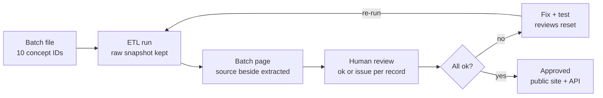

# BDDrug KB — Implementation Plan (Sprint Roadmap + Sprint 1)

Approved 11 Oct 2026 · Author: Khondoker Tanvir Hossain · Living copy: https://claude.ai/code/artifact/1314d107-63c5-4249-9a75-a200dc200206

Implements: [Design Proposal](2026-10-11-bd-drug-kb-design.md). Code-level task plan (every test and code block): [docs/superpowers/plans/2026-10-11-bddrug-sprint-01.md](../superpowers/plans/2026-10-11-bddrug-sprint-01.md).

## Summary

We build BDDrug KB in 1-week sprints, led by AI agents and reviewed by people. Ten pilot medicines go through the whole pipeline first, then we scale in small batches that engineers and pharmacists verify by hand. Sprint 1 delivers a live HTTPS preview site with a batch page for the 10 pilot medicines, each record showing the raw DGDA source beside what we extracted.

## Delivery strategy

Small, human-checked steps catch extraction errors while they are cheap to fix. Large unreviewed runs hide them, and agent-written code can make plausible-looking mistakes.

**Phase A — Pilot 10 (Sprints 1–3).** Ten medicines go through every stage before anything scales: DGDA product → ingredient parse → substance (`BDS-` ID) → synonyms, RxCUI and ATC → clinical drug → DDInter mapping → interactions → site. The pharmacist confirms the final 10.

| Pilot medicine | Edge case it tests |
| --- | --- |
| Napa (paracetamol) | INN vs USAN name (Acetaminophen in DDInter) |
| An amlodipine besilate brand | Salt suffix |
| A warfarin brand | Many major interactions |
| An aspirin brand | Pairs with warfarin (Major) |
| A clarithromycin brand | Pairs with simvastatin (Major) |
| A simvastatin brand | Other half of that pair |
| An amoxicillin + clavulanic acid brand | Combination product |
| A chloramphenicol eye drop | Route-specific DDInter entry |
| A domperidone brand | Not in DDInter, so it must show "no data" |
| A metformin hydrochloride brand | Salt suffix on a very common drug |

**Phase B — Gated batches (Sprint 4 onwards).** Each batch is a list of DGDA concept IDs committed to the repo (`batches/NNNN-name.txt`), chosen in order of generic popularity.

**Batch size rule**

- Start at 10 records per batch.
- Move up to 50, then 100, only after two batches in a row with at most one issue each and no systemic bug.
- A batch with more than 5% issues, or any systemic bug, drops back to 10 until the cause is fixed and covered by a test.

The DGDA pull is a straight copy from a government API. Once the pilot proves the copy is faithful, the team may choose to pull the full raw catalog at once and batch-review only the interpretation stages. That is a team decision, not a default.

## Batch review workflow

Every batch loops until a person has marked every record ok. Re-running a batch resets its reviews, so an old "ok" never covers re-extracted data. Only records a person marked ok reach the public site.

In Sprint 1, review results go in a shared sheet. From Sprint 2, signed-in reviewers mark ok or issue directly on the batch page.

## Sprint roadmap

| Sprint | Theme | What testers see at the end |
| --- | --- | --- |
| S1 | Skeleton + DGDA stage, pilot 10 | Pilot batch page with raw source beside extracted fields; search and product pages; HTTPS, CI/CD, rate limit, API not public |
| S2 | Substances and codes, pilot 10; login | Ingredient parse, `BDS-` substances, salt stripping, INN/BAN/USAN synonyms, RxCUI and ATC, clinical drug, all with evidence. Keycloak login and captcha; per-record ok/issue buttons. |
| S3 | DDInter stage, pilot 10; pilot sign-off | Polite crawl of only the pilot substances; route scope; interactions and "no data" on substance pages; checker page v0. Pharmacist signs off the whole pilot. |
| S4 | Batch machinery hardened | Batch status workflow, batch report (counts, unmatched, diff vs previous run), single-record re-run; batches 0002–0003 |
| S5 | Batches at 10, then 50 | Fixes from batch findings, each with a regression test; "Flag a problem" on every public page |
| S6 | Batches toward 100; disease mapping | Disease name → ICD-10/11 mapping, reviewed per batch |
| S7 | Pharmacist workbench v1 | Queue across batches and flags, bulk approve of exact-synonym groups, "verified by" badges |
| S8 | Interaction checker v1 | Pick brands → alerts by severity; gold test set of 200 known interactions in CI |
| S9 | Releases and QA | Monthly release snapshot of approved records only; QA gates; release changelog |
| S10 | Partner API | API keys, metering, OpenAPI docs, load test (p95 under 300 ms for a 10-drug check) |
| S11 | Niramoy integration | Existing `Medicines` mapped to DAR numbers; the e-Rx calls the check |
| S12 | Hardening | Security review, backup and restore drill, coverage push toward v1 targets |

## Sprint 1: scope, stack and constraints

**Goal:** a pharmacist opens `https://<preview-domain>/batches/0001-pilot` and sees the 10 pilot products, each with the raw DGDA source beside the extracted fields and a link to the original record. Every push to `main` redeploys. Nothing outside the pilot batch is loaded.

| Layer | Choice |
| --- | --- |
| ETL | Python 3.12, httpx 0.27, psycopg 3.2, pytest 8.3, respx 0.21, testcontainers 4.8 |
| API | Java 21, Spring Boot 3.4.2 (WebFlux, R2DBC), Testcontainers 1.20.4, Flyway 10 |
| Web | Next.js 15.1.6, React 19.0.0, Vitest 2.1.8 |
| Data | PostgreSQL 16 with pg_trgm |
| Edge and delivery | Traefik v3.2, Docker Compose on our VM, GitHub Actions, GHCR images, private GitHub repo |

**Global constraints**

- Brands come only from DGDA-Drugs on `https://api.tr.ocl.dghs.gov.bd` (owner `MoHFW`). MedEx-derived data is never shown or served.
- Our own permanent `BDS-` substance IDs, with external codes as crosswalks (from Sprint 2).
- "No interaction data" is never shown as "no interactions" (from Sprint 3).
- Browsing is open; flag and request actions need Keycloak login plus captcha (Sprint 2).
- No secrets in code: `.env` on the VM and GitHub Actions secrets only.
- API responses use the platform envelope `{success, data, message, errors, metadata{timestamp, requestId}}`.
- Commits follow `type(scope): description` with scopes `etl`, `api`, `web`, `db`, `deploy`.
- The system holds no patient data and never logs any.

## Sprint 1 tasks

| # | Task | Produces | Tests that must pass |
| --- | --- | --- | --- |
| 1 | Repo, schema, local compose | `raw.ocl_concept`, `curated.brand_product`, `curated.brand_product_ingredient`; compose with db + Flyway | Flyway applies V1; tables listed |
| 2 | OCL client | `get_concept(owner, source, id) → dict \| None`; `iter_concepts(owner, source)` paged by the `next` header | Follows `next`; literal "None" ends; raises on 5xx; requests `includeMappings=true`; 404 → `None` |
| 3 | Concept → product transform | `concept_to_product(concept) → ProductRow \| None` | Maps extras and ingredients; collapses whitespace; empty quality flag → null; skips non-Drug and retired; drops retired and non-ingredient mappings |
| 4 | Loader + batch runs + CLI | `ops.batch`, `ops.batch_item` (V2); `load_products`, `read_batch_file`, `run_batch`; CLI `bddrug-etl --batch <file>` | Idempotent re-run; missing ID → `issue` "not found at source"; re-run resets review to `pending`; batch file ignores comments, blanks, duplicates |
| 5 | Products API | `GET /v1/products?q=&page=` and `GET /v1/products/{conceptId}` | 2–100 char query, page 0–500, else 400 `INVALID_QUERY`; `%`/`_` literal; Bengali → empty list; unknown → 404 |
| 6 | Server-rendered site | `/` and `/products/[id]`; server-only API client; security headers; `noindex` | Client tests; `next build` succeeds |
| 6A | Batch evidence view | `GET /v1/batches[/{id}]`; `/batches` and `/batches/[id]` with source and extracted side by side | Source beside extracted; missing item shows `issue`; unknown batch → 404 |
| 7 | Production compose | Traefik + Let's Encrypt; only `web` routed; rate limit 10/s burst 30; HSTS; internal network | `docker compose config` valid |
| 8 | CI/CD | `ci.yml`, `deploy.yml`, `load-dgda.yml` | CI green; deploy smoke check 200 |

## Review focus

| Input or condition | Expected behaviour | Test in |
| --- | --- | --- |
| Search containing `%`, `_` or `\`, or Bengali text | Literal match; never "match everything" or a 500 error | Task 5 |
| Empty, 1-character or 101+ character query; page outside 0–500 | Clear 400 with `INVALID_QUERY` | Task 5 |
| DGDA product with no ingredient mapping | Page renders and says "No ingredient mapping from DGDA" | Tasks 5 and 6 |
| OCL pull dies mid-run, then re-runs | No duplicates, no stale ingredients; review resets to `pending` | Task 4 |
| Concept ID in a batch file that OCL doesn't know | Run finishes; item `issue` "not found at source"; rest loads | Task 4 |

## Sprint 1 definition of done

- [ ] CI green on `main`; deploys run automatically.
- [ ] Pilot batch `0001-pilot` loaded on the VM: 10 requested, 10 loaded, 0 missing, or each missing one explained.
- [ ] An engineer and a pharmacist compared all 10 records on the batch page and recorded the result in the review sheet.
- [ ] Every issue found has a failing test and a fix before Sprint 2 starts.
- [ ] A tester outside the office network can open the batch and product pages over HTTPS.
- [ ] The API is unreachable from the internet, and the rate limit was seen returning 429.
- [ ] Sprint demo held; observations logged as input to the Sprint 2 plan.

**Needed from people outside engineering**

| Need | From | When |
| --- | --- | --- |
| Confirm the 10 pilot brands | Pharmacist | Before the pilot run |
| Private GitHub repo and secrets `VM_HOST`, `VM_USER`, `VM_SSH_KEY`, `PREVIEW_DOMAIN` | Product owner / DevOps | Before Task 8 deploys |
| DNS record for the preview domain; ports 80 and 443 open | DevOps | Before Task 8 deploys |
| Review the 10 pilot records on the live batch page | Engineer + pharmacist | End of Sprint 1 |
